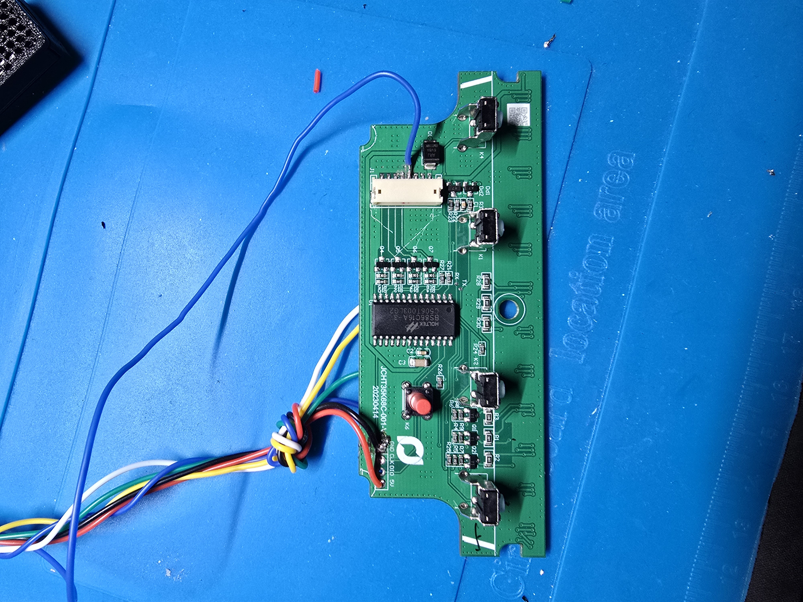
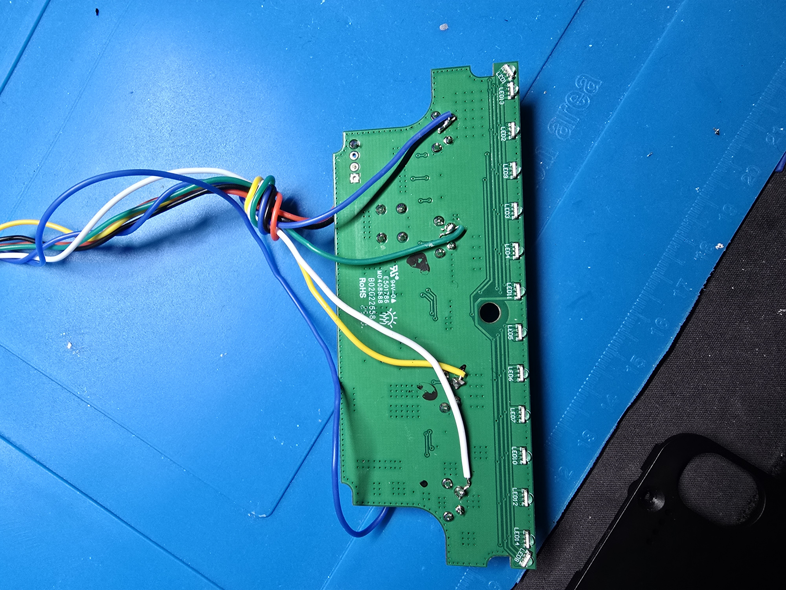

# Hardware Variants

This file documents alternate hardware setups that people have gotten working
against this project's ESPHome approach, where the panel PCB or the MCU
differs enough from the original build that a straight copy of
`esphome/qbus-desk.yaml` won't work as-is.

If your panel and MCU match the original README/HARDWARE.md, you don't need
this file.

---

## Variant: Seeed Studio XIAO ESP32-C3 + Holtek BS86C16A-3 panel

**MCU:** Seeed Studio XIAO ESP32-C3 (instead of the ESP32 WROOM-32 DevKit)

**Handset panel:** a different revision than the one described in
`HARDWARE.md` — mine is built around a **Holtek BS86C16A-3** ("Touch A/D
Flash MCU") rather than whatever drives the panel in the original teardown.
Button pad layout and pinout are different enough that the original photos
and pin descriptions don't transfer directly.


*Front of the panel PCB — Holtek BS86C16A-3 in the middle, the 4 physical buttons (K1/K2/K4/K6) below it, and the connector header (GND/CLK/DIO/5V, RX/TX silkscreened next to the chip) top-left.*


*Reverse side — the LED1-LED14 pad row along the bottom edge, and the GND/CLK/DIO/5V header where the wire bundle is tapped.*

### Finding the right pins

The Holtek BS86C16A-3 has two pin groups that are easy to confuse if you're
going in without a datasheet in hand:

- **PA0 / PA2** — the OCDS/ICP 2-wire *programming* interface (used by Holtek's
  own programmer at the factory). These are **not** a usable runtime data
  line — probing them gets you nothing useful in normal operation.
- **PA3 (RX) / PA7 (TX)** — the actual runtime UART pins the panel uses to
  talk to the desk controller. **PA3 is the one you want to tap** for a
  read-only monitor (see Hardware section below) — it carries the same
  traffic the original project's LIN-bus tap picks up on their panel, just
  on a genuine two-wire UART instead of a single-wire LIN line.

If you find yourself probing a 2-pin header near the chip and getting silence
during normal button presses, you've probably found the ICP header, not the
data line — move to the UART pins instead.

### Wiring

Same button-tap approach as the original project (solder to the 4 button pads
+ GND, open-drain GPIO on the ESP side), remapped to GPIOs that are free on
the XIAO ESP32-C3:

```
[Handset panel, Holtek BS86C16A-3]
   |     |     |     |     |          |
  UP   DOWN   M1    M2    GND      PA3 (RX, UART data)
   |     |     |     |     |          |
[GPIO2][GPIO3][GPIO4][GPIO5][GND]  [GPIO20]   <-- XIAO ESP32-C3
   (open-drain mode)                  (UART RX monitor)
```

Power: same 5V rail from the desk controller as the original project, wired
to the XIAO's 5V pin.

### ESPHome config

Use [`esphome/qbus-desk-xiao-c3.yaml`](esphome/qbus-desk-xiao-c3.yaml) instead
of `qbus-desk.yaml`. It's the same feature set (UP/DOWN/M1/M2 switches and
buttons, HA entities) with:

- `esp32: board: esp32-c3-devkitm-1`, `variant: esp32c3` (instead of the
  WROOM-32 board id)
- Buttons remapped from GPIO26/27/33/32 → GPIO2/3/4/5
- UART RX remapped from GPIO16 → GPIO20

**What's confirmed working:** manual UP/DOWN/M1/M2 control from Home
Assistant, exactly like the original project.

**What's not confirmed:** live height/position tracking and go-to-position.
The UART frame sync byte pattern on this panel is `18 18 06 1E`, not the
`0x55 0x92` pattern documented in [PROTOCOL.md](PROTOCOL.md) for the original
hardware (see the addition at the bottom of that file). I wasn't able to
conclusively identify which byte(s) encode position from the capture logs I
had — the desk_position/desk_height sensors and go-to-position slider are
carried over in the yaml as-is from upstream but should be treated as
**unverified** on this panel until someone re-derives the framing. If you
have this same panel and get further with it, please update this doc.

### Troubleshooting: handset stuck with all LEDs solid green

While wiring this up, disconnecting/reconnecting the panel (including once
with the ESP fully unplugged) left the handset in a state with **all LEDs
solid green and only the DOWN button responding** to physical presses. This
isn't documented anywhere in IKEA's official MITTZON materials (the closest
documented states are red-blinking = locked, green-blinking = unlock
confirm, white-blinking = memory-save confirm, orange steady = reset mode,
orange-blinking = abnormal status, blue steady = overheat protection — solid
green isn't one of them).

This turned out to be a lost position-encoder sync, not a wiring fault or
damaged hardware. **Fix:** drive the desk all the way down to its physical
bottom limit. That forces the controller to re-home, and normal operation
(including all handset LEDs/buttons) resumes. If your desk has limited
cable slack and can't reach full bottom, take up whatever slack you can
first — a full bottom-out is what triggers the re-home, not just "most of
the way."
